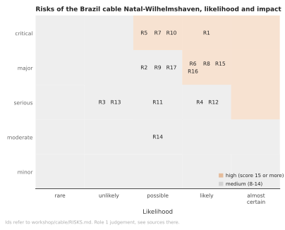

<!--
SPDX-FileCopyrightText: Contributors to PyPSA-Eur <https://github.com/pypsa/pypsa-eur>

SPDX-License-Identifier: CC-BY-4.0
-->

# Risks of the Brazil cable (role 1)

Reference route Natal–Wilhelmshaven, depth-aware via the English Channel,
9,275 km, 4 GW, commissioning 2040 central. Status: first version, public data
only. Likelihood and impact are role 1 judgement on a 1–5 scale; the measured
exposure below is computed, not judged.

## Summary

1. **Depth is the risk that decides feasibility.** 2,358 km of the route lie
   deeper than any HVDC power cable has been qualified for (3,000 m), and
   4,512 km deeper than any has been laid (2,150 m). No route avoids this: it
   comes from crossing the equatorial Atlantic.
2. **Repair, not failure, drives availability.** Deep water rarely damages a
   cable, but a repair there needs a specialised vessel, a spare length and
   calm weather; months out of service per fault are plausible.
3. **One 4 GW link is a single point of failure** larger than the 3 GW
   reference incident the Continental European grid is dimensioned for. It
   should be built as two or more independent bipoles.
4. **Politics is as large as technology.** The depth-aware route crosses the
   waters of 11 states besides Brazil and Germany, including about 800 km off
   Western Sahara, a disputed territory. Long-term offtake is uncertain:
   Xlinks (Morocco–UK, 3.6 GW, 4,000 km) lost its UK support in June 2025.
5. **Ecology is manageable but sets the landfalls.** The Wadden Sea World
   Heritage site at Wilhelmshaven and marine protected areas off Natal are the
   critical points; deep-sea effects of a buried or surface-laid cable are
   small compared with the shelf.



## Measured exposure (`results/risk_exposure.csv`)

From `cable_risk_exposure.py`: GEBCO_2025 bathymetry and Marine Regions World
EEZ v12 (low resolution, so zone lengths are approximate to tens of km).

| | Reference | Short, deep | Around Scotland | Portugal |
|---|---|---|---|---|
| Length, km | 9,275 | 8,304 | 10,385 | 6,356 |
| Shelf, 200 m or less (anchors, fishing), km | 2,391 | 1,536 | 3,499 | 298 |
| Deeper than laid so far (2,150 m), km | 4,512 | 6,676 | 4,512 | 4,242 |
| Deeper than qualified (3,000 m), km | 2,358 | 6,422 | 2,358 | 2,238 |
| Steep seabed (slope over 10 %), km | 1,620 | 514 | 1,620 | 1,188 |
| High seas, km | 1,311 | 4,674 | 1,311 | 1,304 |
| In foreign EEZs, km | 6,410 | 2,920 | 7,452 | 3,652 |
| Number of foreign EEZs | 11 | 5 | 13 | 8 |
| Closest to Atol das Rocas MPA, km | 138 | 151 | 138 | 138 |

Foreign EEZs on the reference route, km: Spain 1,306, Western Sahara 810,
Portugal 764, United Kingdom 704, Morocco 630, France 592, Senegal 528,
Mauritania 486, Guinea-Bissau 270, Netherlands 262, Gambia 58. Plus Brazil
1,400, Germany 154, high seas 1,311.

The trade-off between routes is clear: the depth-aware route buys shallower
water with 2–3 times more foreign waters and more shelf (fault-prone) km. The
short route stays on the high seas but is twice as long in uncharted depth.

## Risk register (`risk_register.csv`)

Score = likelihood x impact. High: 15 or more. Medium: 8–14.

### Technical

| Id | Risk | L | I | Score | Mitigation | In the model |
|---|---|---|---|---|---|---|
| R1 | **Cable design and laying beyond 3,000 m** (2,358 km). The cable has to carry its own weight in the water column during laying; tension rises with depth. Mass-impregnated and extruded HVDC cables have been laid to about 1,640 m (SAPEI, 2011) and 2,150 m (the deepest cited in the role brief); 3,000 m is qualified but not built. | 4 | 5 | **20** | Qualification programme for lighter (aluminium conductor, lighter armour) cables; route optimisation; decision gate before procurement | Depth premium in the cost levels; high case 2.5x above 3,000 m |
| R2 | **Steep slopes** (1,620 km steeper than 10 %): canyons and scarps along the African and Iberian margin; turbidity currents and slides break cables (e.g. the Congo Canyon telecom cable breaks in 2020) | 3 | 4 | 12 | Detailed survey; route around canyons; slack management | Contingency |
| R3 | **Converter and protection** on a 9,300 km DC link: fault clearing, control, no precedent at this length (longest HVDC links are overhead, about 3,000 km) | 2 | 3 | 6 | VSC with DC breakers or converter-based fault clearing; proven technology at each end | Converter cost range |

### Availability and repair

| Id | Risk | L | I | Score | Mitigation | In the model |
|---|---|---|---|---|---|---|
| R4 | **Shelf faults** (2,391 km at 200 m or less): anchors and bottom fishing cause most submarine cable faults (ICPC; CIGRE TB 379, 2009) | 4 | 3 | 12 | Burial 1–3 m on the shelf, rock protection, notification to fishers and shipping | Availability (fault rate shallow) |
| R5 | **Deep-water repair**: few vessels can recover a power cable from 3,000–5,000 m; joints at that depth have no track record; spares must be stored; weather windows in the North Atlantic | 3 | 5 | **15** | Spare cable and joints in stock; repair-vessel agreement; several bipoles so a fault takes out only part | Availability (repair days deep, 60–120); high case 0.69 |
| R6 | **Single point of failure**: loss of 4 GW exceeds the 3 GW reference incident of Continental Europe (ENTSO-E); a whole-link trip would need more reserves or be inadmissible | 4 | 4 | **16** | Build as 2–3 independent bipoles on separate routes or separated by several km; limit infeed per bipole to below 3 GW | Not modelled (the model has no N-1); design requirement |

### Security

| Id | Risk | L | I | Score | Mitigation | In the model |
|---|---|---|---|---|---|---|
| R7 | **Sabotage and deliberate damage**: Baltic incidents 2023–2024 (Balticconnector gas pipeline and telecom cables, Estlink 2 in December 2024) show that cables are targets; 9,300 km cannot be watched | 3 | 5 | **15** | Monitoring (distributed fibre sensing along the cable), naval cooperation, redundancy, fast repair | Not modelled; run without the cable as the downside |

### Political and permits

| Id | Risk | L | I | Score | Mitigation | In the model |
|---|---|---|---|---|---|---|
| R8 | **Consent in 11 foreign EEZs**. UNCLOS: all states may lay cables on the continental shelf and in the EEZ, but the coastal state can set conditions and must consent to the route of pipelines (Art. 79); on the high seas laying is free (Art. 87, 112). In practice every state with territorial sea or shelf on the route runs its own permit and environmental assessment | 4 | 4 | **16** | Intergovernmental agreement Brazil–EU; early engagement; route on the high seas where depth allows | Commissioning range 2035–2045 |
| R9 | **Western Sahara** (about 800 km): disputed territory; whose consent is needed is contested; EU court rulings (CJEU, October 2024) on agreements covering its waters | 3 | 4 | 12 | Route further offshore (more depth) or on the high seas | Route alternative |
| R10 | **Offtake and political support**: Xlinks lost its UK Contract for Difference in June 2025 and with it its offtake route, although privately financed. Without a long-term contract or regulated return the cable cannot be financed | 3 | 5 | **15** | EU Project of Common/Mutual Interest status, regulated asset base or intergovernmental contract; Role 4 cost of capital | Scenario without cable; `cable-wacc` |
| R11 | **Brazil's priorities**: in dry years or under grid stress, Brazil may restrict exports or divert to domestic demand and hydrogen (Pecém hub) | 3 | 3 | 9 | Contract terms; dedicated generation (Role 2) | Not modelled |

### Ecology

| Id | Risk | L | I | Score | Mitigation | In the model |
|---|---|---|---|---|---|---|
| R12 | **Wadden Sea World Heritage site** (UNESCO 2009) at the Wilhelmshaven landfall: crossings take years to permit and have seasonal windows (bird breeding and resting) | 4 | 3 | 12 | Use existing corridors (as NordLink, offshore grid connections), horizontal drilling, construction windows | Contingency; commissioning range |
| R13 | **Brazilian marine protected areas**: the route passes about 140 km from Atol das Rocas, 160 km from the St Peter and St Paul archipelago and 280 km from Fernando de Noronha; coastal reefs near Natal | 2 | 3 | 6 | Route survey, landfall away from reefs | Not modelled |
| R14 | **Shelf habitats** along West Africa and Iberia (reefs, seagrass, fishing grounds) and effects of the cable: magnetic field and heating (small for a bipole with close conductors) | 3 | 2 | 6 | Burial, bundled bipole, environmental assessment per state | Not modelled |

### Supply chain and economics

| Id | Risk | L | I | Score | Mitigation | In the model |
|---|---|---|---|---|---|---|
| R15 | **Factory and vessel capacity**: about 9,300 km of HVDC cable (per bipole) competes with the offshore wind build-out in Europe; HVDC cable factories are booked for years | 4 | 4 | **16** | Early reservation; split production over several suppliers; phase the bipoles | Commissioning 2035–2045 |
| R16 | **Cost overrun** of a first-of-a-kind megaproject | 4 | 4 | **16** | Staged decisions, fixed-price contracts where possible | Cost levels low / central / high, contingency 10–35 % |
| R17 | **Low utilisation**: Brazilian supply, German prices or curtailment do not fill the cable | 3 | 4 | 12 | Size the cable to the supply (Role 2) | Model result (cable flow) |

## Who carries which risk

Proposal for the discussion with role 4 (financing):

| Risk | Natural owner | Instrument |
|---|---|---|
| Depth, design, laying (R1, R2, R15) | Manufacturer / EPC contractor up to qualification; then the owner | Fixed-price EPC with performance guarantees; public support for the qualification programme |
| Repair and availability (R4, R5) | Owner / operator | Spare-parts pool, insurance, availability-based regulation |
| Sabotage (R7) | States | Public security; possibly state guarantee |
| Permits and politics (R8, R9, R10, R11) | Governments of Brazil and Germany / EU | Intergovernmental agreement, PCI/PMI status, regulated return |
| Cost overrun (R16) | Shared, with a cap | Regulated asset base with cost sharing; public lenders (EIB, BNDES) |
| Utilisation (R17) | Generator in Brazil or offtaker in Germany | Long-term contract (CfD or capacity-based payment) |

## What the model reflects, and what it does not

- **In the cost levels:** R1, R2, R3, R16 (depth premium, converter range,
  contingency).
- **In availability (`p_max_pu`):** R4, R5 as an average derating.
- **In the commissioning range:** R8, R12, R15.
- **Not in the model:** N-1 security (R6), sabotage (R7), political
  interruption (R10, R11). Their downside is the run **without the cable**: if
  the German system has to be secure without it, the cable cannot replace firm
  capacity. Role 3/4: count the cable as energy, not as secured capacity.

## What would have to change for the risks to be acceptable

1. A cable qualified and demonstrated at 4,000–5,000 m (or a route that stays
   shallower than 3,000 m, which the bathymetry does not offer).
2. A proven deep-water repair capability with a guaranteed vessel and spares.
3. Two or more bipoles below 3 GW each.
4. An intergovernmental framework covering all states on the route.
5. Long-term offtake or a regulated return, so that political risk is not
   priced into the cost of capital.

## Sources

Public sources, accessed or published as stated. Entries marked *(verify)* are
from general knowledge and must be checked before they go on a slide.

- UNCLOS (1982), Part VI Art. 79 and Part VII Art. 87, 112–115, un.org,
  accessed 2026-11-27.
- Xlinks, Morocco–UK Power Project, xlinks.co, accessed 2026-11-27: 3.6 GW,
  4,000 km; UK government decided in June 2025 not to progress a CfD.
- GEBCO Compilation Group (2025), GEBCO_2025 Grid, doi:10.5285/37c52e96-24ea-67ce-e063-7086abc05f29.
- Flanders Marine Institute (2023), Maritime Boundaries Geodatabase, World EEZ
  v12, marineregions.org, CC-BY 4.0 (in `data/eez/`).
- Deepest HVDC cable laid 2,150 m, qualified 3,000 m: workshop role brief
  (`workshop/roles/1-cable.md`).
- CIGRE TB 379 (2009), Update of service experience of HV underground and
  submarine cable systems *(verify)*.
- ICPC (International Cable Protection Committee): fishing and anchors as main
  cause of submarine cable faults *(verify)*.
- ENTSO-E: 3 GW reference incident for Continental Europe *(verify)*.
- SAPEI (Sardinia–Italy, 2011), laid to about 1,640 m *(verify)*.
- Congo Canyon turbidity current breaking the WACS and SAT-3 cables, 2020 *(verify)*.
- Balticconnector (October 2023) and Estlink 2 (December 2024) damage *(verify)*.
- CJEU judgments of 4 October 2024 on EU–Morocco agreements and Western
  Sahara *(verify)*.
- UNESCO World Heritage List, Wadden Sea (2009) *(verify)*.

## Reproduce

```bash
pixi run python workshop/cable/cable_route.py          # routes (first)
pixi run python workshop/cable/cable_risk_exposure.py  # measured exposure
pixi run python workshop/cable/plot_risk_matrix.py     # risk matrix figure
```
